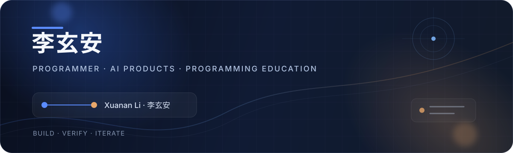

  <picture>
    <source media="(prefers-color-scheme: dark)" srcset="https://raw.githubusercontent.com/lixuanan2/lixuanan2/main/assets/profile-header-dark.svg" />
    
  </picture>

  <strong>简体中文</strong> · <a href="./README_EN.md">English</a> 
  <a href="mailto:lixuanan2@163.com">邮件联系</a> · <a href="#联系玄安">工作与合作</a> · <a href="#玄安的创作笔记">内容方向</a>

### 我是李玄安，一名走向编程教育的程序员。

曾在**葡萄牙里斯本大学理学院（FCUL）学习信息工程**。从 Web、移动端应用到业务自动化工具，我逐渐把软件开发与 AI 产品实践延伸到**少儿编程教育、机器人赛事和代码编程竞赛相关项目**。

现在，我在做 Python / C++ 课程、交互课件和教学辅助工具，也在筹备自己的视频账号。希望把产品开发、课程设计和竞赛项目中的具体经验，讲成别人能理解、能跟着做的内容。

> **写代码，做产品，也把编程讲明白。**

 

## 现在，主要做三件事

**01 / 用 AI 做实用产品**

把需求整理成可使用的软件。做过 Web 与移动端应用、本地工具，以及物流业务中的对账、订单流转和路线规划相关工具。关注 AI 怎样改善开发、文档处理和信息整理中的实际流程。

**02 / 把编程变成孩子能完成的作品**

围绕青少年 Python / C++ 学习设计课程、交互课件、练习和项目任务。把知识点拆成小步骤，给学生留下动手验证和解释作品的空间；用 AI 辅助备课，再逐项核对示例、答案与难度。

**03 / 参与机器人与编程竞赛项目**

参与赛事资料、报名流程和相关工具建设，逐步整理竞赛学习内容。已开发机器人赛事报名汇总助手，覆盖邮件附件、本地 OCR、Excel 整理、去重和人工复核，让繁杂资料更容易核查。

 

## 从留学到教育，我带来了什么

- **信息工程学习经历** — 在葡萄牙学习计算机相关知识，积累葡萄牙语沟通和跨文化生活经验。
- **软件开发实践** — 经历需求梳理、数据建模、界面开发、测试与版本迭代，把想法推进到可运行的结果。
- **教育工具视角** — 把工程方法用于课程准备、练习检查和赛事资料流程，让老师与项目人员减少重复工作。

公开作品将按主题逐步整理，具体仓库名单确认后再更新。涉及学生和业务信息的项目，以脱敏案例展示。

 

## 玄安的创作笔记

**视频账号筹备中。** 我准备从这些主题开始持续记录：

| 栏目 | 会分享的内容 |
| :--- | :--- |
| **玄安做产品** | AI 小工具如何从需求走到可用版本，功能取舍与开发复盘 |
| **玄安讲编程** | Python / C++ 课程拆解、互动练习，以及一个知识点怎样变成作品 |
| **竞赛项目幕后** | 机器人赛事资料流程、竞赛项目准备与工具实践 |
| **留学之后** | 葡萄牙信息工程学习经历，以及走向少儿编程教育的过程 |

账号与首批视频上线后，会在这里更新入口。

<strong>展开我的技术与工作方式</strong>

 

- **课程与代码：** Python · C++ · Java · TypeScript / JavaScript
- **应用与工具：** React Native / Expo · Angular · Node.js · Flask · Spring Boot
- **数据与交付：** PostgreSQL · MongoDB · SQLite · Git · Docker
- **教育研发：** 课程拆解 · 交互课件 · 项目练习 · 教师资料 · 结果验证
- **工作方式：** 先理解流程 → 小步实现 → AI 辅助 → 人工复核 → 测试与复盘

 

## 联系玄安

欢迎交流 **AI 产品开发、少儿编程课程、教学与赛事工具、技术内容共创**，也欢迎相关岗位与项目机会。

**[lixuanan2@163.com](mailto:lixuanan2@163.com)** · 微信：`lixuanan2` 
添加时请备注「GitHub + 公司 / 项目 / 来意」。招聘沟通可通过邮箱索取简历。

---

  李玄安 · Xuanan Li 代码连接想法，作品连接成长。

