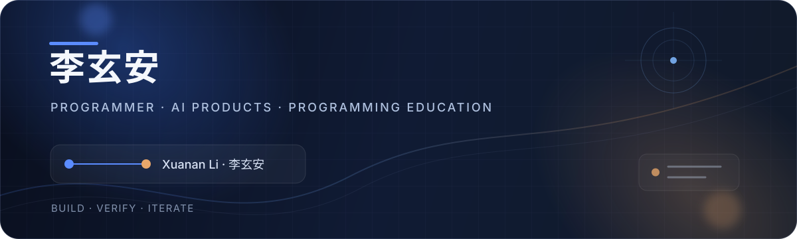

<div align="center">
  
</div>

<div align="center">
  <a href="./README.md">简体中文</a> · <strong>English</strong>
</div>

<div align="center">
  
  <a href="mailto:lixuanan2@163.com?subject=GitHub%20Opportunity"></a>
  
  <a href="https://github.com/lixuanan2/focus-assistant"></a>
</div>

## Hello, I'm Jiarong 👋

I'm an Informatics Engineering graduate who enjoys turning fuzzy ideas into **working, testable, and maintainable** software. My current interests include AI applications, Java / Web, full-stack development, local-first products, and practical digital tools for traditional businesses such as logistics.

I use AI as a development accelerator without outsourcing judgment to it. Requirement framing, technical trade-offs, code review, testing, and delivery remain my responsibility.

### A 30-second introduction

| | |
| --- | --- |
| 🎓 **Education** | Informatics Engineering · Faculty of Sciences, University of Lisbon (FCUL) |
| 📍 **Location** | Seeking opportunities in Beijing; shaped by years of study and life in Portugal |
| 🎯 **Roles** | AI application, Java / Web, junior full-stack, technical implementation and support |
| 🗣️ **Languages** | Native Chinese · Fluent Portuguese · Technical English |
| 🧩 **Strengths** | From requirements to prototypes, workflow modeling, AI-assisted development, local verification, and iterative delivery |

## Contact & opportunities

I'm open to junior software and technical roles in Beijing, including positions that connect Chinese and Portuguese-speaking teams or markets.

- **Recruiting / project enquiries:** [Send me an email](mailto:lixuanan2@163.com?subject=GitHub%20Opportunity) at `lixuanan2@163.com`
- **WeChat:** `lixuanan2` — please include “GitHub + company / role” in your request
- **Code and public work:** [github.com/lixuanan2](https://github.com/lixuanan2)
- **Full résumé:** Available by email; please include your company, role, and name

> To protect personal and client data, private work is described through capabilities, architecture, and outcomes—not real operational records.

## What I'm building

| Project | What it solves | Stack | Stage |
| --- | --- | --- | --- |
| **CrushOS** | A private, local-first relationship journal that turns people, interactions, plans, reminders, and shared expenses into a calm personal system. | Expo · React Native · TypeScript · SQLite | Private beta |
| [**Focus Assistant**](https://github.com/lixuanan2/focus-assistant) | A browser extension with grouped blocking rules, multiple focus modes, schedules, and progressive strictness. | JavaScript · Manifest V3 · Local Storage | Public · Iterating |
| **Logistics workflow tools** | Practical tools for bid monitoring, reconciliation, order workflows, and company web presence. | Python · Flask · NestJS · PostgreSQL · SQLite | Private work |
| [**Taxi WebApp**](https://github.com/lixuanan2/taxy-webapp) | A multi-role taxi system covering map-based booking, dispatch, pricing, invoices, history, and reports. | Angular · Node.js · Express · MongoDB · Leaflet | Course project |
| **TascaEats** | A delivery platform evolved from a Spring Boot monolith into web, desktop, and event-driven delivery services. | Java · Spring Boot · Kafka · gRPC · Docker | Course project |

## Toolbox

```text
Languages     Java · TypeScript · JavaScript · Python · SQL
Product       React Native / Expo · Angular · Node.js · NestJS · Flask · Spring Boot
Data          PostgreSQL · MongoDB · SQLite
Delivery      Git / GitHub · Docker · REST · gRPC · Kafka · Automated testing
Workflow      Requirement framing · AI-assisted coding · Local verification · Iterative delivery
```

## How I like to work

- **Start from the real workflow.** I map users, decisions, data, and edge cases before adding features.
- **Use AI with ownership.** AI helps me explore and move faster; I still inspect the code, run tests, and make the final trade-offs.
- **Prefer useful over impressive.** A small tool that survives daily use is more valuable than a large demo nobody can maintain.
- **Protect private data.** Personal and client projects demonstrate capability without exposing conversations, accounts, or real records.

## Selected public work

| [Focus Assistant →](https://github.com/lixuanan2/focus-assistant) | [Taxi WebApp →](https://github.com/lixuanan2/taxy-webapp) |
| --- | --- |
| Browser-level focus rules designed around real bypass behavior, not just a blocklist. | A complete three-role workflow from map-based booking to trip reports and invoices. |
| `JavaScript` `Manifest V3` `Local-first` | `Angular` `Node.js` `MongoDB` `Leaflet` |

---

<div align="center">
  <sub>Building practical software, one verified iteration at a time.</sub><br />
  <sub><a href="mailto:lixuanan2@163.com?subject=GitHub%20Opportunity">Have a relevant opportunity? Let's talk.</a></sub>
</div>
